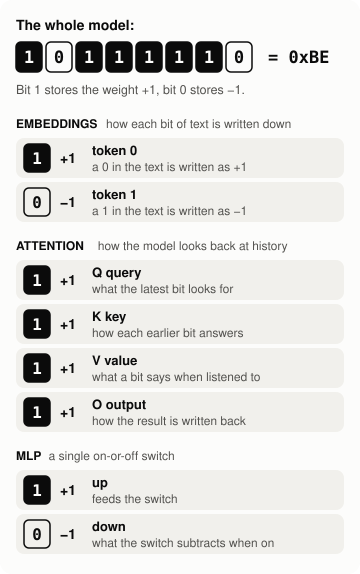
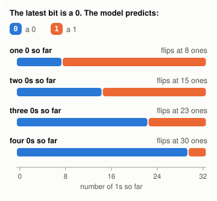

# byte-lm: the one-byte transformer

A complete, working transformer language model whose entire set of weights is 8 bits: the byte `0xBE`.

It is the same kind of machine as the large language models behind chatbots, shrunk until nothing more can be removed. It was set by hand, not trained. It still has every standard part: a tokenizer, embeddings, causal self-attention, an MLP, a residual stream, normalization, and a softmax over a vocabulary.

## What it does, in one minute

The model reads a string of 0s and 1s and guesses the next one. Its whole behaviour fits in two questions:

<p align="center"><picture>
<source media="(prefers-color-scheme: dark)" srcset="figures/rule-dark.svg">

</picture></p>

So it mostly repeats the latest bit. The exception is the interesting part: when it sees a 0, it looks back over *everything* it has read, and if 1s overwhelm 0s by more than about 7.39 to 1, it decides the 0 was a fluke and predicts 1 anyway.

## The whole model

These are all of the weights. Each is +1 or −1, stored as one bit.

<p align="center"><picture>
<source media="(prefers-color-scheme: dark)" srcset="figures/byte-dark.svg">

</picture></p>

The file [`weights.bin`](weights.bin) in this repository is that byte and nothing else.

## How it thinks

Here is one prediction, start to finish, for the input `1 1 0`. The number on the right of each step is the model's single running value, its residual stream.

<p align="center"><picture>
<source media="(prefers-color-scheme: dark)" srcset="figures/pipeline-dark.svg">

</picture></p>

Each part has one job:

- **Attention** takes a vote over the history. Bits that match the latest bit get a louder voice.
- **The MLP switch** turns on only when the latest bit is a 0. It erases that bit's own contribution, so the vote alone decides. When the latest bit is a 1 the switch stays off, and the bit itself decides.
- **Normalization** throws away everything about a number except whether it is positive or negative.

## The tipping point

In the vote, a bit that matches the latest bit pulls with strength e ≈ 2.72, and a bit that differs pulls with strength 1/e ≈ 0.37. One 0 can therefore hold out against seven 1s, but not eight:

<p align="center"><picture>
<source media="(prefers-color-scheme: dark)" srcset="figures/tipping-point-dark.svg">

</picture></p>

The exchange rate is 2.72 ÷ 0.37 = e² ≈ 7.39 ones per zero. Every extra 0 in the history raises the bar by another 7.39:

<p align="center"><picture>
<source media="(prefers-color-scheme: dark)" srcset="figures/flip-dark.svg">

</picture></p>

A tie can't occur, because e² is irrational.

## Try it

It needs only Python 3 and no packages.

```
$ python3 onebyte.py predict 11111110
P(next = 0) = 0.8808
P(next = 1) = 0.1192

$ python3 onebyte.py predict 111111110
P(next = 0) = 0.1192
P(next = 1) = 0.8808
```

`trace` prints every intermediate value:

```
$ python3 onebyte.py trace 110
...
attention output  m = +0.5740
residual add      x = +1.5740
MLP hidden unit   1
after MLP         x = +0.5740
```

`generate` samples a continuation. The output comes in runs, because the model usually expects the same bit again:

```
$ python3 onebyte.py generate 0 --n 40 --seed 1
0 0000000000000000011000111100000000000000
```

`text` reads ordinary text as the bits of its UTF-8 bytes, and `--weights`, placed before the command as in `onebyte.py --weights 0x7A predict 10`, runs any of the other 255 models. `python3 onebyte.py --help` lists everything.

## Design

Each choice is the smallest version of a standard component.

- **Tokenizer:** text is read as raw bits, so the vocabulary is {0, 1}. Two tokens is the minimum, because a softmax over one token always outputs probability 1 whatever the weights are.
- **Width:** the residual stream is one number per position.
- **Layers:** one block, with one attention head and an MLP with one hidden unit.
- **Weights:** each is ±1, stored as one bit. There are no biases.
- **Embeddings:** the input and output embeddings are tied, so there are two weights, one per token.
- **Normalization:** RMSNorm with no learned gain, applied before attention, before the MLP, and before the output. At width 1, it reduces to taking the sign.
- **Position:** no positional encoding. The causal mask is the only source of order.

That gives 2 embedding weights, 4 attention weights (Q, K, V, O) and 2 MLP weights (up, down): 8 bits. Writing +1 as bit 1 and −1 as bit 0, in that order, gives `10111110` = `0xBE`.

## The forward pass, exactly

Let σⱼ be the embedding of the token at position j: +1 for a 0, −1 for a 1. To predict the token after position i:

1. **Attention.** The score for each earlier-or-current position j is σᵢσⱼ: +1 if token j matches the current token, −1 if not. Softmax turns these into weights, so each matching token gets weight proportional to e and each non-matching one to 1/e. The output is the weighted average of the σⱼ, a number m strictly between −1 and +1.
2. **Residual add.** x = σᵢ + m. Since |m| < 1, x keeps the sign of σᵢ.
3. **MLP.** x ← x − ReLU(sign(x)). This subtracts 1 when x is positive and does nothing when x is negative.
4. **Output.** y = sign(x). The logits are (+y, −y) for tokens (0, 1), so the model predicts one of them with probability σ(2) ≈ 0.88.

Let n₀ and n₁ be the counts of 0s and 1s so far, including the current token.

- **Current token is 1:** x is negative, the ReLU stays off, and the model predicts 1.
- **Current token is 0:** x = 1 + m, and the MLP subtracts exactly the 1, leaving m. So the prediction is the sign of m, which is positive exactly when n₀·e > n₁/e, that is, when n₁ < e²·n₀.

## Checked, not just derived

```
$ python3 onebyte.py check
8190 bit strings up to length 12: the model matches
the rule on every one, each time with confidence 0.8808
```

The check runs the real forward pass on every bit string of length 1 to 12 and compares it with the two-question rule. `--max-len 16` extends it to 131,070 strings, which also all match.

## Why it's interesting

- **It counts over an unbounded prefix.** Attention computes a soft fraction of matching tokens across the whole history. No fixed-order n-gram can do that, so even one byte of transformer falls outside the n-gram class. A bigram over bits needs 2 parameters; the extra bits here buy counting.
- **Each component does one job.** Attention aggregates the history. The single ReLU fires only on token 0, where it cancels the token's own embedding so the history decides the outcome. On token 1 it stays off and the token's identity decides.
- **The norm choice matters.** RMSNorm at width 1 passes one bit, the sign. LayerNorm subtracts the mean first, which at width 1 leaves a constant, so the model would ignore its context entirely.

## Caveats

- **Redundant bits.** Q and K only act through their product, as do V and O, so the 8 stored bits describe at most 6 bits of distinct behaviour. Measured, it is fewer: `python3 onebyte.py survey` compares all 256 weight bytes on every bit string up to length 10 and finds 11 distinct behaviours. `0xBE` shares its behaviour with seven other bytes, and the 128 bytes whose two embeddings are equal can only ever answer 50/50.
- **Not a good language model.** It is a "sticky" predictor with a majority override. The point is that the architecture survives at this size and still does something a lookup table can't.
- **Floating point.** The code computes in ordinary double precision. Histories long enough for n₁/n₀ to land within rounding error of e² would need exact arithmetic; nothing near the tested lengths comes close.

## Files

- [`onebyte.py`](onebyte.py): the model, the rule and the command line.
- [`weights.bin`](weights.bin): the weights, one byte.
- [`figures/make_figures.py`](figures/make_figures.py): redraws the figures above, taking their numbers from the model.

Released under the [MIT License](LICENSE).
