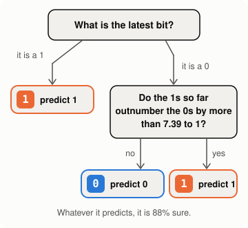
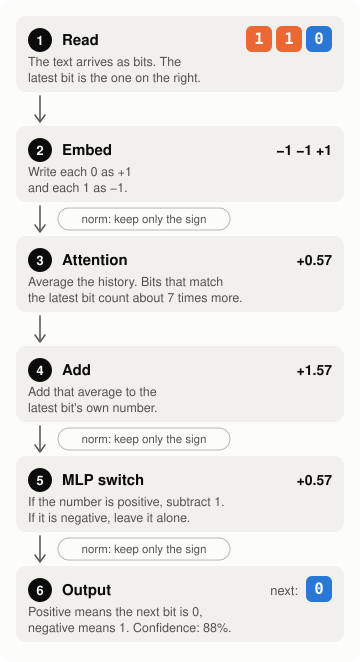
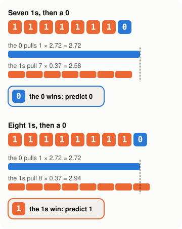

# byte-lm: the one-byte transformer

A complete, working transformer language model whose entire set of weights is 8 bits: the byte `0xBE`.

It is the same kind of machine as the large language models behind chatbots, shrunk until nothing more can be removed. It was set by hand, not trained. It still has every standard part: a tokenizer, embeddings, causal self-attention, an MLP, a residual stream, normalization, and a softmax over a vocabulary.

## What it does, in one minute

The model reads a string of 0s and 1s and guesses the next one. Its whole behaviour fits in two questions:

<p align="center"><picture>
<source media="(prefers-color-scheme: dark)" srcset="figures/rule-dark.svg">

</picture></p>

So it mostly repeats the latest bit. The exception is the interesting part: when it sees a 0, it looks back over *everything* it has read, and if 1s overwhelm 0s by more than about 7.39 to 1, it decides the 0 was a fluke and predicts 1 anyway.

## The whole model

These are all of the weights. Each is +1 or −1, stored as one bit.

<p align="center"><picture>
<source media="(prefers-color-scheme: dark)" srcset="figures/byte-dark.svg">

</picture></p>

The file [`weights.bin`](weights.bin) in this repository is that byte and nothing else.

## How it thinks

Here is one prediction, start to finish, for the input `1 1 0`. The number on the right of each step is the model's single running value, its residual stream.

<p align="center"><picture>
<source media="(prefers-color-scheme: dark)" srcset="figures/pipeline-dark.svg">

</picture></p>

Each part has one job:

- **Attention** takes a vote over the history. Bits that match the latest bit get a louder voice.
- **The MLP switch** turns on only when the latest bit is a 0. It erases that bit's own contribution, so the vote alone decides. When the latest bit is a 1 the switch stays off, and the bit itself decides.
- **Normalization** throws away everything about a number except whether it is positive or negative.

## The tipping point

In the vote, a bit that matches the latest bit pulls with strength e ≈ 2.72, and a bit that differs pulls with strength 1/e ≈ 0.37. One 0 can therefore hold out against seven 1s, but not eight:

<p align="center"><picture>
<source media="(prefers-color-scheme: dark)" srcset="figures/tipping-point-dark.svg">

</picture></p>

The exchange rate is 2.72 ÷ 0.37 = e² ≈ 7.39 ones per zero. Every extra 0 in the history raises the bar by another 7.39:

<p align="center"><picture>
<source media="(prefers-color-scheme: dark)" srcset="figures/flip-dark.svg">

</picture></p>

A tie can't occur, because e² is irrational.

## Try it

It needs only Python 3 and no packages.

```
$ python3 onebyte.py predict 11111110
P(next = 0) = 0.8808
P(next = 1) = 0.1192

$ python3 onebyte.py predict 111111110
P(next = 0) = 0.1192
P(next = 1) = 0.8808
```

`trace` prints every intermediate value:

```
$ python3 onebyte.py trace 110
tokens            1      1      0
embeddings        -1.000 -1.000 +1.000
norm before attn  -1.000 -1.000 +1.000
attention scores  -1.000 -1.000 +1.000
attention weights +0.107 +0.107 +0.787
attention output  m = +0.5740
residual add      x = +1.5740
norm before MLP   +1
MLP hidden unit   1
after MLP         x = +0.5740
norm before out   y = +1
logits (0, 1)     +1.000 -1.000
P(next = 0), P(next = 1) = 0.8808, 0.1192
```

`generate` samples a continuation. The output comes in runs, because the model usually expects the same bit again:

```
$ python3 onebyte.py generate 0 --n 40 --seed 1
0 0000000000000000011000111100000000000000
```

`text` reads ordinary text as the bits of its UTF-8 bytes, and `--weights`, placed before the command as in `onebyte.py --weights 0x7A predict 10`, runs any of the other 255 models. `python3 onebyte.py --help` lists everything.

## The architecture, step by step

The rest of this page walks through the forward pass one component at a time. Each step gives the standard form of the component, what that form collapses to here, the lines of [`onebyte.py`](onebyte.py) that implement it, and the matching rows of `trace 110`. Where the component has a weight, there is an exercise: flip its bit with `--weights`, predict what changes, then run it.

Three sizes describe a transformer: the vocabulary size V, the width d of the residual stream, and the sequence length T. Here V = 2 and d = 1, so every vector is a single number and every weight matrix is a single ±1.

| Step | Standard part | Weights here |
|---|---|---|
| 1 | Tokenizer | none |
| 2 | Embedding, V × d | `emb0`, `emb1` |
| 3 | Normalization | none |
| 4 | Attention: four d × d matrices | `Q`, `K`, `V`, `O` |
| 5 | Residual add | none |
| 6 | MLP: up d → h, down h → d | `up`, `down` |
| 7 | Output: norm, unembedding, softmax | none (reuses the embedding) |

That is 8 weights. Writing +1 as bit 1 and −1 as bit 0, in that order, gives `10111110` = `0xBE`.

The whole forward pass is the 18 lines of `forward()`, quoted in full below, piece by piece. In the formulas, i is the position being predicted from, j ranges over the positions it can see, and h is a normalized copy of the stream.

### 1. Tokenize

A tokenizer maps text to a sequence of integers below V. Production models use V in the tens of thousands, with one token per word fragment. This one reads the bits of the UTF-8 bytes, so V = 2. That is the minimum: a softmax over one token outputs probability 1 whatever the weights are.

```python
def text_to_bits(text):
    return [(b >> (7 - i)) & 1 for b in text.encode("utf-8") for i in range(8)]
```

```
tokens            1      1      0
```

The `text` command shows the tokenization of any string:

```
$ python3 onebyte.py text A
01000001
P(next = 0) = 0.1192
P(next = 1) = 0.8808
```

### 2. Embed

```
x_j = E[t_j]          E is a V × d table, one row per token
```

The embedding looks up a vector for each token. With d = 1 the table is two numbers: token 0 becomes +1 and token 1 becomes −1. Call the result σⱼ. These values start the **residual stream**: one vector per position, which every later component reads from and adds to.

```python
emb = (w["emb0"], w["emb1"])
stream = [emb[t] for t in tokens]
```

```
embeddings        -1.000 -1.000 +1.000
```

Most models also add a positional vector here, or rotate the attention inputs by position. This one does neither, so the only thing that tells positions apart is the causal mask in step 4.

**Exercise.** `0x7E` swaps the two embeddings and leaves the other six weights alone. What does it predict after `111111110`, and after `000000001`?

<details>
<summary>Answer</summary>

It predicts 0 both times. The model is mirrored: after a 0 it always predicts 0, and after a 1 it predicts 1 unless the 0s outnumber the 1s by more than e² to 1.

The plain "repeat the latest bit" behaviour survives the swap, because the same two numbers are used again at the output (step 7) and the two sign changes cancel. The override does not survive, because the MLP switch fires on a positive stream, and positive now means token 1.

Flipping `up` and `down` as well (`0x7D`) moves the switch back, and the behaviour is exactly that of `0xBE` again. The sign of the stream is a convention; only the relationships between weights matter.

</details>

### 3. Normalize

```
RMSNorm(x) = g · x / sqrt(mean(x²))          g is a learned gain, omitted here
```

RMSNorm rescales a vector to a fixed length and keeps its direction. In one dimension the only direction is the sign, so the norm maps every positive number to +1 and every negative number to −1.

```python
def rms_norm(x):
    return 0.0 if x == 0 else x / math.sqrt(x * x)
```

```
embeddings        -1.000 -1.000 +1.000
norm before attn  -1.000 -1.000 +1.000
```

The norm runs three times: before attention, before the MLP, and before the output. This arrangement is called **pre-norm**, and it has a consequence that is easy to miss: the norm is applied to the copy of the stream that a component reads, not to the stream itself. The stream keeps its magnitude. In step 5 it holds +1.574, a value no norm output could be, and in step 6 the model depends on that.

The choice of norm matters at this size. LayerNorm subtracts the mean of the vector before rescaling, and the mean of one number is the number, so every component would read zero and the model would ignore its input.

### 4. Attention

```
scores    s_ij = (W_Q h_i) · (W_K h_j) / sqrt(d)      for j ≤ i only
weights   α_ij = softmax of s_ij over j
output    m_i  = W_O Σ_j α_ij W_V h_j
```

Attention is how one position reads from the others. Position i builds a query, every visible position j offers a key, and the dot product of query and key scores how relevant j is. A softmax turns the scores into weights that sum to 1, and the output is the weighted average of the values, passed through an output matrix. The restriction j ≤ i is the **causal mask**: a position cannot see what comes after it.

Here all four matrices are ±1 and h is the sign of σ, so:

```
s_ij = QK σ_i σ_j = +1 if token j matches token i, −1 if not
```

After the softmax, each matching token has weight proportional to e and each non-matching token has weight proportional to 1/e. The output m is the weighted average of the σⱼ. It always lies between −1 and +1, and it reaches ±1 only when every bit so far is the same.

```python
normed = [rms_norm(x) for x in stream]
query = w["Q"] * normed[-1]
scores = [query * w["K"] * h for h in normed]
peak = max(scores)
unnormalized = [math.exp(s - peak) for s in scores]
total = sum(unnormalized)
attention = [u / total for u in unnormalized]
attended = w["O"] * sum(a * w["V"] * h for a, h in zip(attention, normed))
```

```
attention scores  -1.000 -1.000 +1.000
attention weights +0.107 +0.107 +0.787
attention output  m = +0.5740
```

For `110` the latest bit is a 0. It matches itself and disagrees with the two 1s, so it takes 79% of the weight, and m = 0.787 − 0.107 − 0.107 = +0.574.

Two details of the code: subtracting `peak` before `exp` only prevents overflow and does not change the weights, and there is no explicit mask because the code computes the last position only, which is allowed to see everything.

**Exercise 1.** `0x9E` flips `Q`. What are the attention weights for `110`, and what does the model predict?

<details>
<summary>Answer</summary>

The scores change sign, so tokens that *differ* from the latest bit now get the louder voice:

```
$ python3 onebyte.py --weights 0x9E trace 110
...
attention scores  +1.000 +1.000 -1.000
attention weights +0.468 +0.468 +0.063
attention output  m = -0.8732
...
```

It predicts 1. The exchange rate is inverted: after a 0, this model predicts 0 only if the 0s outnumber the 1s by more than e² to 1.

</details>

**Exercise 2.** `0x8E` flips both `Q` and `K`. What changes?

<details>
<summary>Answer</summary>

Nothing. The score contains only the product QK, so the two flips cancel and `0x8E` computes the same function as `0xBE`. The same is true of real models: the scores depend on W_Qᵀ W_K, and many different pairs of matrices give the same product.

</details>

**Exercise 3.** `0xB6` flips `V`. What does it predict for `110`? For `111`?

<details>
<summary>Answer</summary>

`Q` and `K` decide where to look; `V` and `O` decide what gets written. Flipping `V` leaves the attention weights for `110` unchanged and negates the output, m = −0.574. The stream becomes 1 − 0.574 = +0.426, the MLP subtracts 1, and the model predicts 1. After a 0 this model predicts the *minority* bit.

For `111` the output is 50/50. Every bit is the same, so the vote is unanimous and the negated output is exactly +1, which cancels the latest bit's −1. The stream is exactly 0, and the norm has no sign to report.

</details>

### 5. Residual add

```
x ← x + Attention(Norm(x))
```

A component never overwrites the stream. It adds its output to what is already there. For the last position, that is the bit's own embedding plus the vote:

```
x = σ_i + m
```

```python
after_attention = stream[-1] + attended
```

```
residual add      x = +1.5740
```

The stream now carries two things in one number. Its sign is still the sign of σᵢ, because m can't outweigh it, so the sign says what the latest bit is. The distance from ±1 says how the vote went.

### 6. MLP

```
x ← x + W_down · ReLU(W_up · Norm(x))
```

The MLP works on each position separately. It projects the stream up to a hidden layer, applies a nonlinearity, and projects back down. The hidden layer is usually about 4d wide, the nonlinearity is usually a smooth variant of ReLU, and both projections usually have biases. Here the hidden layer is one unit, with `up` = +1, `down` = −1 and no biases:

```
x ← x − ReLU(sign(x))
```

This subtracts 1 when x is positive and does nothing when x is negative.

```python
mlp_in = rms_norm(after_attention)
hidden = max(0.0, w["up"] * mlp_in)
after_mlp = after_attention + w["down"] * hidden
```

```
norm before MLP   +1
MLP hidden unit   1
after MLP         x = +0.5740
```

When the latest bit is a 0, x = 1 + m is positive, the unit fires, and subtracting 1 leaves m alone: the bit's own contribution is erased and only the vote remains. When the latest bit is a 1, x is negative, the unit stays off, and the bit's own −1 still dominates.

**Exercise.** `0xBF` flips `down` and `0xBC` flips `up`. What does each predict after `111111110`, where `0xBE` predicts 1?

<details>
<summary>Answer</summary>

Both predict 0, and both do nothing more than repeat the latest bit on every input.

With `down` flipped, the unit still fires on a 0 but adds 1 instead of subtracting it, so the stream goes from +0.96 to +1.96 and the bit's own contribution is reinforced. With `up` flipped, the unit fires on a 1 instead, where it pushes a negative stream further negative, and never fires on a 0.

In both models attention still runs and still writes the vote into the stream. The vote has no effect, because it is smaller than the bit's own ±1 and the output keeps only the sign. Attention moves information to the position that needs it; here it takes the MLP to make that information count.

</details>

### 7. Output

```
y      = Norm(x)
logits = E y                    one logit per token
P      = softmax(logits)
```

A last norm is applied, and the result is compared against each token's embedding by a dot product. Using the embedding table again for this is called **weight tying**, and it is why the output costs no extra bits. Here y is ±1, so the logits are (+y, −y) for tokens (0, 1): a positive stream means the next bit is 0. The softmax gives the preferred token probability e/(e + 1/e) = 1/(1 + e⁻²) ≈ 0.88.

```python
y = rms_norm(after_mlp)
logits = (y * emb[0], y * emb[1])
exps = [math.exp(v) for v in logits]
probs = tuple(e / sum(exps) for e in exps)
```

```
norm before out   y = +1
logits (0, 1)     +1.000 -1.000
P(next = 0), P(next = 1) = 0.8808, 0.1192
```

**Exercise.** `0xFE` sets both embeddings to +1. What does it predict?

<details>
<summary>Answer</summary>

50/50 on every input. Both tokens get the same logit, and a softmax depends only on the differences between logits. The model also can't tell its two input tokens apart. The same holds for all 128 bytes whose two embedding bits are equal.

</details>

### Putting it together

Let n₀ and n₁ be the counts of 0s and 1s so far, including the latest bit.

- **Latest bit is 1:** x = −1 + m is negative, the ReLU stays off, and the model predicts 1.
- **Latest bit is 0:** x = 1 + m, and the MLP subtracts exactly the 1, leaving m. The prediction is the sign of m:

```
m = (n₀·e − n₁/e) / (n₀·e + n₁/e)
```

This is positive exactly when n₁ < e²·n₀, which is the two-question rule at the top of this page.

## Checked, not just derived

```
$ python3 onebyte.py check
8190 bit strings up to length 12: the model matches
the rule on every one, each time with confidence 0.8808
```

The check runs the real forward pass on every bit string of length 1 to 12 and compares it with the two-question rule. `--max-len 16` extends it to 131,070 strings, which also all match.

## What width 1 hides

Every component above is the real one, but some of what you saw is a property of width 1 and does not carry over to larger models.

- **Normalization keeps one bit.** In d dimensions a norm discards one number, the length, and keeps the other d − 1. Here that leaves only the sign.
- **The confidence never changes.** The final norm outputs ±1 and the embeddings are ±1, so the logits are always ±1 and the answer is always given at 88%. A larger model varies its confidence through the angle between the stream and each token's embedding.
- **The attention is never sharp or flat.** The scores are always ±1, so one token is at most e² times louder than another. Real scores range widely, and a head can put nearly all its weight on one token.
- **Q, K, V and O have nothing to select.** In a wide model they are matrices that pick which directions of the stream to compare, which to copy, and where to write the result, so different heads can read and write different information without colliding. With one direction, everything reads and writes the same number. Multiple heads, and several features sharing a stream, need width.
- **Only the last position is computed.** That is valid with one layer, because a position's prediction depends only on the embeddings it can see. In a deeper model the second layer reads what the first layer wrote at *every* position, so all positions are computed, and training scores the prediction at every position at once. The causal mask exists to make that possible.
- **Order is almost invisible.** With no positional encoding, the model knows which bit is latest and how many of each bit came before, and nothing else: `0110` and `1010` get the same prediction.
- **Nothing was learned.** The weights were chosen by hand, and ±1 weights can't be reached by plain gradient descent. Nothing on this page says anything about how training finds weights.

## Capstone: the other 255 models

```
$ python3 onebyte.py survey
11 distinct behaviours among the 256 weight bytes,
compared on every bit string up to length 10:
   8 bytes  0x41 0x4D 0x71 0x7D 0x82 0x8E 0xB2 0xBE
   ...
  32 bytes  0x40 0x43 0x4C 0x4F 0x50 0x53 0x5C 0x5F ...
  32 bytes  0x44 0x47 0x48 0x4B 0x54 0x57 0x58 0x5B ...
 128 bytes  0x00 0x01 0x02 0x03 0x04 0x05 0x06 0x07 ...
```

There are eight groups of 8 bytes, two groups of 32 and one group of 128. **Exercise:** explain why, using the answers to the exercises above.

<details>
<summary>Answer</summary>

**128 bytes: equal embeddings.** The two tokens can't be told apart and the output is always 50/50 (step 7).

For the other 128 bytes, the behaviour depends on only four signs:

- QK, the product of `Q` and `K`: whether matching or differing tokens get the louder voice.
- VO, the product of `V` and `O`: whether the vote is written as it is or negated.
- `up` × `emb0`: whether the MLP unit fires on token 0 or on token 1.
- `down` × `emb0`: whether a firing unit pushes the stream toward that token's own embedding or away from it.

Each combination of the four signs is produced by 8 bytes: two ways to split QK, two ways to split VO, and two overall signs for the stream (swap the embeddings and flip `up` and `down` with them). That gives 16 combinations of 8 bytes each.

**Eight groups of 8: the unit cancels.** When a firing unit pushes away from its token's embedding, it erases the latest bit and exposes the vote, as in `0xBE`. The three remaining signs each change the result, giving 8 different behaviours.

**Two groups of 32: the unit reinforces.** When a firing unit pushes toward its token's embedding, the vote never matters and the model repeats the latest bit (step 6). QK and the choice of firing token then make no difference, so the combinations merge four at a time. They merge into two groups and not one because of VO: with the vote negated, a unanimous history cancels the latest bit exactly and gives 50/50 (step 4, exercise 3), and with it written as it is, that never happens.

1 + 8 + 2 = 11.

</details>

## Why it's interesting

Attention computes a soft fraction of matching tokens across the whole history. No fixed-order n-gram can do that, so even one byte of transformer falls outside the n-gram class. A bigram over bits needs 2 parameters; the extra bits here buy counting.

## Caveats

- **Not a good language model.** It is a "sticky" predictor with a majority override. The point is that the architecture survives at this size and still does something a lookup table can't.
- **Redundant bits.** The 8 stored bits describe only 11 behaviours, as the capstone shows, and `0xBE` shares its behaviour with seven other bytes.
- **Floating point.** The code computes in ordinary double precision. Histories long enough for n₁/n₀ to land within rounding error of e² would need exact arithmetic; nothing near the tested lengths comes close.

## Files

- [`onebyte.py`](onebyte.py): the model, the rule and the command line.
- [`weights.bin`](weights.bin): the weights, one byte.
- [`figures/make_figures.py`](figures/make_figures.py): redraws the figures above, taking their numbers from the model.

Released under the [MIT License](LICENSE).
